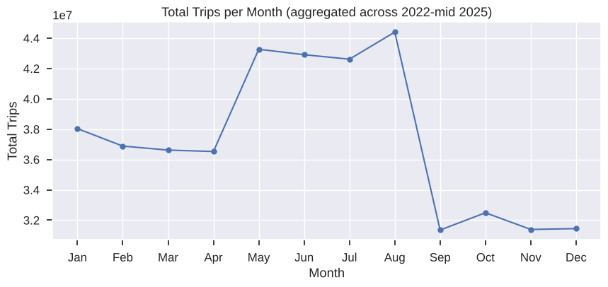
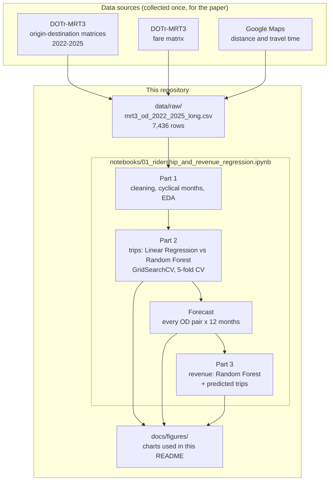
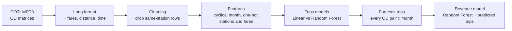
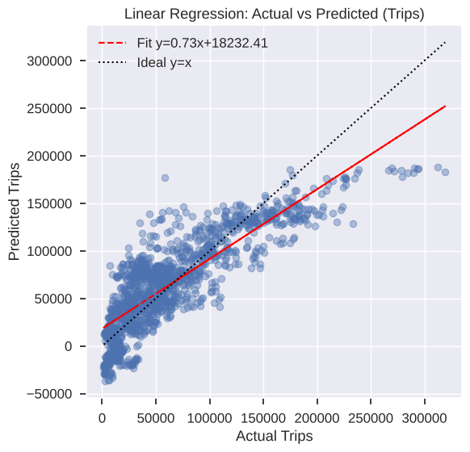
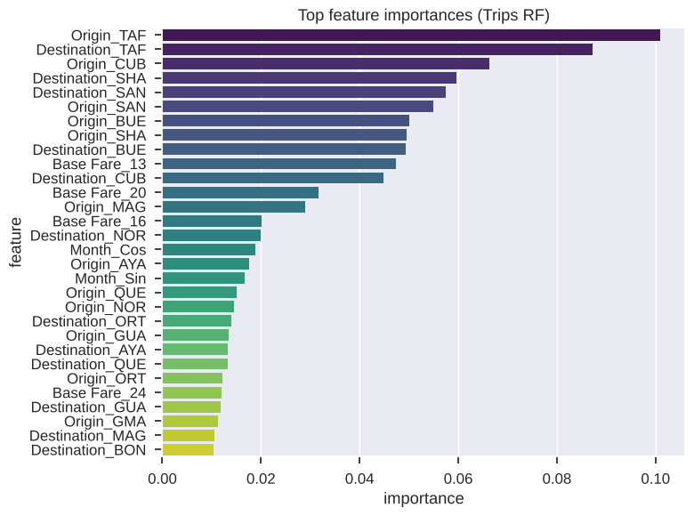
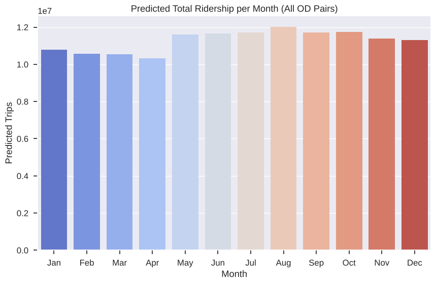
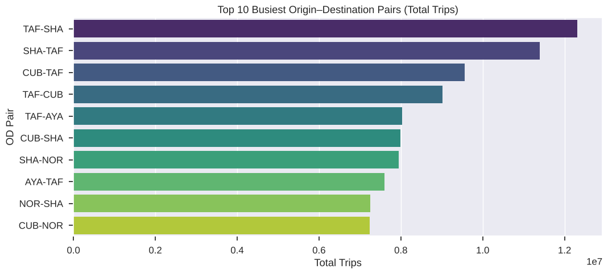
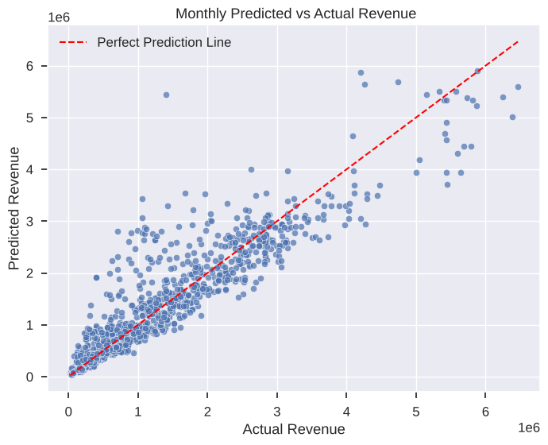

# MRT-3 Ridership and Revenue Prediction (2022-2025)

**A data-driven analysis of Metro Manila's MRT-3: which station pairs carry the most riders, which months are busiest, and how well machine learning can predict monthly trips and revenue.**

This repository holds the regression part of a group study, which James built (the models and their data preprocessing), *A Data-Driven Analysis of MRT-3 Monthly Ridership Dynamics (2022-2025): Examining Origin-Destination Patterns and Operational Efficiency*, written at the Technological Institute of the Philippines (TIP). It predicts monthly trips and revenue for every MRT-3 origin-destination (OD) pair, from January 2022 to August 2025, and compares Linear Regression with Random Forest Regression.

| Model | Target | Test R² | Test MAE |
|---|---|---|---|
| Linear Regression | Monthly trips per OD pair | 71.11% | 22,681 trips |
| Random Forest (tuned) | Monthly trips per OD pair | **86.30%** | **12,620 trips** |
| Random Forest (tuned) | Monthly revenue per OD pair | **85.6%** | ₱242,888 |



## Contents

- [In plain words](#in-plain-words)
- [System architecture](#system-architecture)
- [Problem statement](#problem-statement)
- [Research questions and objectives](#research-questions-and-objectives)
- [Dataset](#dataset)
- [Methodology](#methodology)
- [Results](#results)
- [The full study: classification, clustering and association rules](#the-full-study-classification-clustering-and-association-rules)
- [Repository structure](#repository-structure)
- [Reproduce the results](#reproduce-the-results)
- [Limitations and next steps](#limitations-and-next-steps)
- [Team](#team)
- [References](#references)

---

## In plain words

The MRT-3 runs along EDSA, one of Metro Manila's busiest roads. The government publishes how many people travel between every pair of its 13 stations each month. We used 44 months of that data to teach a computer to estimate how many people will travel between two stations in a given month, and how much fare money that brings in.

The simple method (a straight-line formula) got about 71% of the picture right. A Random Forest, which combines hundreds of small decision trees, got about 86% right and halved the typical error. The busiest trips are between Taft Avenue, Shaw Boulevard and Cubao, and August is the busiest month.

## System architecture

Everything runs in one Jupyter notebook. There is no server or database: the dataset is a CSV file in this repository, and the notebook reads it, trains the models in memory and draws the charts.



| Layer | What | Tools |
|---|---|---|
| Data | One long-format CSV: station pair, month, trips, fare, revenue, distance, time | CSV, pandas |
| Processing | Cleaning, cyclical month encoding, one-hot encoding, scaling | pandas, NumPy, scikit-learn `ColumnTransformer` |
| Models | Linear Regression, Random Forest, hyperparameter search | scikit-learn `Pipeline`, `GridSearchCV` |
| Diagnostics | Residual plots, Q-Q plot, Breusch-Pagan test | statsmodels, matplotlib, seaborn |
| Environment | Google Colab, or any Python 3.11-3.13 with `requirements.txt` | Jupyter |

## Problem statement

The Metro Rail Transit Line 3 (MRT-3) is one of Metro Manila's main commuter corridors along EDSA, yet it still struggles with uneven passenger distribution, route profitability and congestion. Detailed ridership data exists, but there is little analysis of which factors drive trip volumes and revenue, or of how demand differs between origin-destination pairs.

This project uses the official DOTr-MRT3 origin-destination ridership data to answer those questions with machine learning, in support of UN Sustainable Development Goal 11 (Sustainable Cities and Communities).

## Research questions and objectives

The regression part of the study answers the first research question:

> **Which regression algorithm, Linear Regression or Random Forest Regression, predicts MRT-3 ridership and revenue more accurately, and which predictors most strongly influence trips and revenue?**

Objectives:

- Clean and reshape the MRT-3 origin-destination data for 2022 to mid-2025.
- Explore monthly and station-pair ridership patterns.
- Build Linear Regression and Random Forest models for monthly **trips** and **revenue**, and tune the Random Forest with cross-validated grid search.
- Compare the models with R², MAE, MSE and RMSE, and check the linear model's assumptions.
- Use the best model to forecast ridership for every OD pair and month.

## Dataset

**File:** [`data/raw/mrt3_od_2022_2025_long.csv`](data/raw/mrt3_od_2022_2025_long.csv). It has 7,436 rows, one per origin station, destination station and month, covering 44 months (January 2022 to August 2025) across all 13 stations.

**How it was built** (described in the paper):

1. The origin-destination passenger matrices *OD 2022-2023* and *OD 2024-2025* were obtained from the Department of Transportation - MRT-3 (DOTr-MRT3).
2. A preprocessing notebook turned the matrices into long format (one row per OD pair and month) and merged them into one table.
3. The fare for each OD pair was taken from the official [DOTr-MRT3 fare matrix](https://www.dotrmrt3.gov.ph/fare-matrix.pdf).
4. Distance and commute time for each pair were collected from Google Maps.

| Column | Type | Description |
|---|---|---|
| `Year` | int | 2022 to 2025 |
| `Month` | text | January to December (2025 ends in August) |
| `Origin` | text | Station code where the trip started |
| `Destination` | text | Station code where the trip ended |
| `Trips` | int | Passenger trips for that OD pair in that month |
| `Base Fare` | int | Fare in pesos: 13, 16, 20, 24 or 28 (0 for same-station rows) |
| `Revenue` | int | Revenue in pesos. In this file it always equals `Trips` × `Base Fare` |
| `CommuteTime_Mins` | float | Travel time between the stations, in minutes (from Google Maps) |
| `OD_Distance_km` | float | Distance between the stations, in km (from Google Maps) |

**Station codes**, north to south:

| Code | Station | Code | Station |
|---|---|---|---|
| NOR | North Avenue | SHA | Shaw Boulevard |
| QUE | Quezon Avenue | BON | Boni |
| GMA | GMA-Kamuning | GUA | Guadalupe |
| CUB | Araneta Center-Cubao | BUE | Buendia |
| SAN | Santolan-Annapolis | AYA | Ayala |
| ORT | Ortigas | MAG | Magallanes |
|  |  | TAF | Taft Avenue |

## Methodology



### 1. Cleaning

- Dropped the 572 same-station rows (for example NOR to NOR): they record no movement and have a fare of 0. That leaves **6,864 rows**.
- Dropped `Year` so the models learn monthly seasonality rather than a calendar trend.
- Distance and commute time are kept in the dataset but not used by these models.

### 2. Feature engineering

- **Cyclical months:** each month becomes `Month_Sin` and `Month_Cos`, so December sits next to January instead of 11 steps away.
- **Categorical inputs:** `Origin`, `Destination` and `Base Fare` are one-hot encoded.
- **Scaling:** the month features are standardized for Linear Regression only; Random Forest uses them as they are.

### 3. Trips models

- 80/20 train-test split (`random_state=42`): 5,491 training rows, 1,373 test rows.
- **Linear Regression** as the baseline, with residual plots, a Q-Q plot and a Breusch-Pagan test for heteroscedasticity.
- **Random Forest**, first with 200 trees, then tuned with `GridSearchCV` over 48 settings with 5-fold cross-validation (240 fits). Best: 400 trees, `max_depth=20`, `max_features='sqrt'`, `min_samples_split=5`, `min_samples_leaf=2`.

### 4. Forecast

The tuned Random Forest predicts trips for every OD pair in every month of the year, which shows the busiest and quietest months and routes.

### 5. Revenue model

A second Random Forest predicts monthly revenue from the stations, fare, cyclical month and the **predicted trips** from step 4. It was tuned with `GridSearchCV` over 36 settings with 3-fold cross-validation (108 fits). Best: 300 trees, `max_depth=10`, `min_samples_split=5`, `min_samples_leaf=2`.

## Results

### Trips: Random Forest beats Linear Regression

| Model | Split | R² | MAE | RMSE |
|---|---|---|---|---|
| Linear Regression | Train | 71.40% | 23,407 | 30,666 |
| Linear Regression | Test | 71.11% | 22,681 | 29,811 |
| Random Forest (200 trees) | Train | 92.02% | 9,876 | 16,196 |
| Random Forest (200 trees) | Test | 83.24% | 13,969 | 22,705 |
| Random Forest (tuned) | Train | 91.54% | 10,415 | 16,676 |
| **Random Forest (tuned)** | **Test** | **86.30%** | **12,620** | **20,526** |

Tuned Random Forest, 5-fold cross-validation R² on the training set: 88.08%, 87.51%, 88.07%, 87.22%, 86.39% (mean **87.45%**).

- **Linear Regression is stable but limited.** Train and test scores are nearly equal, so it does not overfit, but it explains only about 71% of the variation and is off by about 23,000 trips on average. Its residuals curve and widen for busy routes, and the Breusch-Pagan test (p < 0.05) confirms heteroscedasticity: it underestimates high-volume OD pairs.
- **Random Forest captures what the line misses.** Tuning narrowed the train-test gap of the 200-tree model and lifted test R² from 83.24% to 86.30%, with a 44% lower MAE than Linear Regression.

<p>
  
  
</p>

**What drives trips:** the stations themselves. Taft Avenue (TAF) as origin and destination is the strongest predictor, followed by Cubao (CUB), Shaw Boulevard (SHA), Santolan-Annapolis (SAN) and Buendia (BUE). The 13-peso fare band (the shortest trips) also matters, while the month features matter far less than the route.

### Forecast: busiest and quietest months and routes



- **Busiest month:** August, about **12.0 million** predicted trips across all OD pairs.
- **Quietest month:** April, about **10.3 million** predicted trips.
- **Busiest routes in August:** TAF to SHA (192,160), CUB to SHA (190,561), CUB to TAF (184,628), SHA to TAF (181,891) and TAF to CUB (180,554).
- **Quietest routes in April:** BUE to SAN (9,003), BUE to ORT (9,436), SAN to BUE (9,549), QUE to SAN (9,706) and SAN to BON (9,934).



### Revenue

| Model | Split | R² | MAE (₱) | RMSE (₱) |
|---|---|---|---|---|
| Random Forest (baseline) | Train | 0.926 | 184,440 | 311,087 |
| Random Forest (baseline) | Test | 0.827 | 269,163 | 460,463 |
| Random Forest (tuned) | Train | 0.920 | 191,951 | 317,691 |
| **Random Forest (tuned)** | **Test** | **0.856** | **242,888** | **420,821** |

Best 3-fold cross-validated R² during tuning: 0.885. Predicted trips is by far the most important feature; only the 13, 16 and 24-peso fares add much beyond it. That is expected, since revenue in this data is trips times the fare.



## The full study: classification, clustering and association rules

The paper went beyond regression. Those analyses were done in separate notebooks that are **not in this repository**; their results, as reported in the paper, are:

| Research question | Method | Result (from the paper) |
|---|---|---|
| Can routes be classified as profitable or not? | Logistic Regression vs Random Forest Classifier | Random Forest: 94.2% accuracy, 0.951 precision, 0.929 recall, AUC 0.982. Logistic Regression: 61.3% accuracy, AUC 0.648. Distance, origin, destination and commute time were the strongest predictors. |
| Can OD pairs be grouped by demand? | K-Means (elbow method), shown with PCA | Four clusters: very low, moderate, high and peak demand. Distance, commute time and trip volume shaped the clusters. |
| Which station pairs travel together often or rarely? | Apriori and FP-Growth on August 2025 trips (min support 0.005, min confidence 0.01, adjacent stations excluded) | Both gave identical rules; FP-Growth ran faster. Frequent pairs marked congested corridors; rare non-adjacent pairs marked underused routes for fare incentives. |

**Recommendations in the paper:** keep Random Forest for ridership and revenue forecasting and retrain it on new monthly data; use the classifier to guide fare and resource planning; schedule trains by demand cluster; and offer targeted fare incentives on underused non-adjacent routes to relieve the central corridors.

## Repository structure

```text
├── data/
│   └── raw/
│       └── mrt3_od_2022_2025_long.csv     OD ridership, fares, distance and time, Jan 2022 - Aug 2025
├── notebooks/
│   └── 01_ridership_and_revenue_regression.ipynb   cleaning, EDA, trips and revenue models, forecast
├── docs/
│   └── figures/                           charts used in this README, exported from the notebook
├── requirements.txt                       pinned package versions that reproduce the results
└── README.md
```

## Reproduce the results

The notebook was written in Google Colab. It now reads the dataset straight from `data/raw/`, so it runs locally too. A full run takes about 4 minutes on a laptop, most of it in the two grid searches.

**Prerequisites:** Python 3.11 to 3.13 and Git. VS Code with the Jupyter extension, or JupyterLab, to open the notebook.

```bash
git clone https://github.com/james-kalaw/MRT-3-Regression-Project.git
cd MRT-3-Regression-Project
python -m venv .venv
```

Activate the environment, then install:

```bash
source .venv/bin/activate          # Windows PowerShell: .\.venv\Scripts\Activate.ps1
pip install -r requirements.txt
```

Run every cell and save the outputs:

```bash
cd notebooks
jupyter nbconvert --to notebook --execute --inplace 01_ridership_and_revenue_regression.ipynb
```

Or open the notebook in VS Code or JupyterLab and select **Run All**.

**Expected numbers:** Linear Regression test R² 71.11%; tuned Random Forest test R² 86.30% (best parameters `max_depth=20`, `max_features='sqrt'`, `n_estimators=400`); revenue model test R² 0.856. These match the paper and were re-checked from a fresh copy of this repository with the versions in `requirements.txt`.

**Version note:** use pandas 2.x as pinned. Under pandas 3, text columns are no longer the `object` type, so the notebook's month conversion is skipped and the run fails.

**Google Colab:** upload the notebook and the CSV, then set `DATA_PATH` in the "Load the dataset" cell to the CSV's name.

## Limitations and next steps

- **Random split, not a time split.** Rows are split at random, so the test set contains months from the same years the model trained on. A forecast for unseen future months would be a stricter test: train on 2022 to 2024 and test on 2025.
- **Revenue is trips times fare.** In this data, `Revenue` equals `Trips` × `Base Fare` for every row, so the revenue model mostly re-learns that rule from predicted trips. Its value is in combining the trips forecast with the fare structure, not in finding new drivers of revenue.
- **Predicted trips come from a model trained on the same rows**, which makes the revenue model's test score somewhat optimistic.
- **Monthly totals hide daily peaks**, holidays and service disruptions; the residuals show the largest errors on unusually busy routes and months.
- **Future work in the paper:** time-series models (ARIMA, Prophet, LSTM) for long-term trends; richer data (seasons, ticket types, demographics); gradient boosting or neural networks; temporal clustering of peak and off-peak hours; DBSCAN and hierarchical clustering; sequential association analysis; and GIS or Power BI dashboards for MRT-3 management.

## Glossary

| Term | Meaning |
|---|---|
| OD pair | Origin-destination pair: a trip from one station to another, for example Cubao to Taft Avenue |
| R² | Share of the ups and downs in the data that the model explains; 86% means the model accounts for 86% of the variation |
| MAE | Mean absolute error: on average, how far off a prediction is, in trips or pesos |
| RMSE | Like MAE but punishes big misses more |
| Random Forest | Many decision trees trained on random slices of the data, whose answers are averaged |
| Cross-validation | Training and testing several times on different splits to check the score is not luck |
| Cyclical encoding | Turning months into points on a circle (sine and cosine) so December sits next to January |
| One-hot encoding | Turning a category such as a station into yes/no columns a model can use |
| Heteroscedasticity | Errors that grow for bigger values; here, the linear model misses busy routes by more |

## Team

Technological Institute of the Philippines, BS Data Science and Analytics. Professor: Dr. Rosmina Joy Cabauatan.

- Juliana Ysabel D.C. Detera
- Josh Andrei A. Ituralde
- **James Andre L. Kalaw**: built all the regression models (Linear Regression and Random Forest for trips and for revenue) and their data preprocessing, the work in this repository
- Mia Ysabel R. Semilla

## References

1. AlKhereibi, A. H., Wakjira, T. G., Kucukvar, M., & Onat, N. C. (2023). Predictive machine learning algorithms for metro ridership based on urban land use policies in support of transit-oriented development. *Sustainability, 15*(2), 1718. https://doi.org/10.3390/su15021718
2. Empino, J., Junsay, J. A., Verzon, M. G., Abisado, M., Huyo-a, S. L., & Sampedro, G. A. R. (2023). Smart Metro: Deep learning approaches to forecasting the MRT Line 3 ridership. *International Journal of Computing Sciences Research, 7*, 1923-1936. https://doi.org/10.48550/arXiv.2304.07303
3. Tiznado-Aitken, I., Palm, M., & Farber, S. (2024). Segmenting transit ridership: From crisis to opportunity. *Transportation Research Part A: Policy and Practice, 190*, 104239. https://doi.org/10.1016/j.tra.2024.104239
4. Zhang, J., et al. (2023). Exploring the association between network centralities and passenger flows in metro systems. *Applied Network Science, 8*(1), 45. https://doi.org/10.1007/s41109-023-00583-2
5. Lawan, B. M., Abubakar, J., & Zhang, S. Y. (2024). Comparative analysis of the factors influencing metro passenger arrival volumes in Wuhan, China, and Lagos, Nigeria: An application of association rule mining and neural network models. *Journal of Transportation Technologies, 14*, 607-653. https://doi.org/10.4236/jtts.2024.144033
6. Department of Transportation - MRT-3. Fare matrix. https://www.dotrmrt3.gov.ph/fare-matrix.pdf
